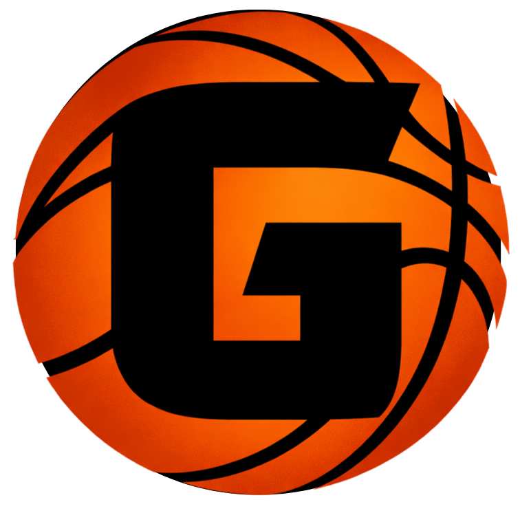

<p align="center">
  
</p>

<h1 align="center">Giddey</h1>

<p align="center">
  <strong>A daily basketball draft puzzle game.</strong><br/>
  Draft 9 players. Build chemistry. Score big.
</p>

<p align="center">
  <a href="https://playgiddey.com">Play Now</a>
</p>

---

## What is Giddey?

Giddey is a browser-based puzzle game inspired by **2K MyTeam** and formation puzzles like Griddy. Each game is a 9-round draft where you're dealt 3 random NBA player cards per round and must pick one to place on a court-shaped grid.

The catch: you can't undo a pick, and your score depends on both the **talent** of the players you draft and the **chemistry** between them on the grid.

Your goal is to maximize your total score out of **279**.

## How Scoring Works

**Talent** — Higher-rated cards earn more points. Cards range from Gold (76 OVR, +1 pt) to Dark Matter (100 OVR, +15 pts). Max talent across 9 cards is 135.

**Chemistry** — Adjacent players on the grid earn chemistry bonuses when they share a **team**, **division**, or **draft year**. Strong connections light up green lines and green dots for big bonus points. Max chemistry is 144.

## The Grid

Your 9 players are arranged in a diamond formation with 15 connections between them:

```
        [SG]    [PF]
  [UTIL] [PG]  [PG] [UTIL]
  [SF]              [SG]
           [C]
```

The **Center** slot is the most connected position on the board (4 neighbors), making it the most important pick. **UTIL** slots accept any position. You can drag cards around to rearrange at any time.

## Features

- **9 card tiers** from Gold to Dark Matter, each with unique 2K-style card art, shimmer effects, and star ratings
- **235+ NBA players** with real headshots, teams, divisions, and draft years
- **Custom hero cards** like Hoodie Melo (Dark Matter, 100 OVR, Knicks)
- **Drag-and-drop** card placement and rearranging (works on mobile too)
- **Optimal lineup solver** that shows the best possible arrangement after you submit
- **Draft odds** that shift each round — early picks have better chances at elite tiers
- **PWA ready** — add to your home screen for a native app feel

## Versus Mode — 2K27 Draft Night

A head-to-head mode at [`/versus`](https://playgiddey.com/versus) for two people building teams to play against each other in NBA 2K27. Ratings are the real 2K27 launch overalls: 209 current players and 136 All-Time legends.

Setup starts with four **quick setups** (Classic, Variety Night, Money Night, Chaos). Below them are seven numbered sections, each with a one-line explanation. The ❓ button opens a step-by-step guide to the night, which marks the steps your current settings turn off and explains every card tag.

**Drafting**
- **Pools:**
  - Modern
  - All-Time
  - Both
  - **Era Wars**: one coach drafts today's players and the other drafts legends, with tiers matched by OVR so it stays fair.
- **Draft styles:**
  - **Pack Snake**
  - **I Cut, You Choose**
  - **Franchise Wheel**
  - **Auction**: a salary-cap draft where you nominate anyone in the pool and bid on them.
  - **Auction Block**: players come up on their own, stars first, with the next 3 lots in view. You bid or pass, and per-tier slots mean nobody can hoard superstars.
- **Custom rosters.** Set how many Superstars, All-Stars, Starters, Rotation and Deep Bench players each coach drafts, or pick a preset (Balanced, Starting Five, Big Three, Superteams, Underdogs, Full Rotation).
- **Handicap mode** gives each coach their own roster build and auction budget. After a game, the loser can set the winner's handicap for the redraft.
- **Position-aware packs** are built around the spots each coach still needs. A live **lineup balance** readout (shooting, playmaking, rim protection, rebounding, depth) shows what each team is missing.
- **Optional extras:**
  - Underdog picks first, plus the **Equalizer** for lopsided drafts
  - Rerolls
  - Mystery packs
  - A **blind bid round**: both coaches pick in secret, and if they take the same player nobody gets him
  - **Keepers** when you redraft
  - A one-offer trade window
- **Theme drafts:** spin a theme wheel before each draft, or lock one in for every draft. Themes include Throwback, 80s & 90s Night, Young Guns, Division Night, East vs West, One Per Franchise, No One Over 95 and Underdog Night. A theme only lands if it leaves enough players for your roster build and draft style.

**Player variety**
- **Freshness boost** (Off / Light / Strong): players neither of you has used come up more often, and the ones you keep taking come up less.
- **Card tags:** 🆕 Never drafted, 🔥 Your 4th time, 🌱 Fresh face, ⭐ Hot hand (a past Player of the Game), 💙 Your guy / 🎯 their guy, and 🔒 Locked with the reason.
- **Fresh Faces** (0–3 per roster): each roster must include players that coach has never used. Once your remaining picks run short, only fresh faces can be taken.
- **Franchise guys:** each coach pins up to 5 favorites. With the **Favorites round** on, each coach grabs one before every draft.
- **Retire winners:** after a win, the winner's Player of the Game (or the whole winning starting five) can't be drafted by that coach for the next 2 drafts. The other coach can still take them.

**Draft night presentation**
- The commissioner's podium intro.
- A 20/30/45-second **shot clock**: beeps in the last 5 seconds, then a buzzer and an auto-pick.
- Synthesized sound effects with a mute toggle.
- A full-screen **BOOM** with the player's headshot for every superstar pick, and a card flip on every other pick.
- An **announcer** reads every pick aloud using the phone's built-in speech voice ("With the 4th pick, Dave selects… Allen Iverson"), with extra hype for superstars. The 🔊 button mutes it.
- **Draft grades:** after the draft, each team gets a letter grade and a one-line analyst take ("Walls up at the rim, nobody to stretch the floor"). Picks get stamped 💰 STEAL (3+ OVR better than the other coach's pick that round) or 🤨 REACH (a player 3+ OVR better was on the board).
- Screen fade transitions, plus vibration on picks, bids, wheel spins, slot stops and the coin flip (on phones that support it).

**Game day**
- **Rules:** one slot-machine pull sets the quarter length (2–5 min) and a scoring twist that pushes the score up: Pace & Space, Make It Rain, Showtime, No Defensive Settings, 4th Quarter Double, Bucket Getters (plus the occasional Straight Up).
- **Challenges:** each coach picks a risk level (Easy, Medium or Hard), then spins a challenge of that difficulty. Completing it banks a reward for the **next draft**, and harder challenges pay more:
  - **Easy:** 🔒 Keeper, ⬆️ Tier Up (your lowest pick moves up a tier), or ➕ +1 Rotation player
  - **Medium:** ⏫ Double Tier Up, 🎯 Guaranteed All-Star, or ➕ +1 Starter
  - **Hard:** 💎 Guaranteed Superstar, 🌟 +1 All-Star, or 👑 +1 Superstar
- **Running it back:** if you keep the same squads instead of redrafting, an extra-player reward signs a free agent of that tier, and any other reward upgrades your weakest player. The Equalizer stays off in a draft where someone has earned a reward.
- Both rosters are listed with headshots.
- **Player of the Game:** each coach votes for anyone from either team. If the votes split, both players get the award.
- **Vegas line:** a point spread set from the team ratings, the quarter length and recent head-to-head margins. Enter the score to settle it; an underdog who covers earns ⬆️ Tier Up for the next draft.
- **Halftime wheel:** tap who's leading at the half, and the trailing team spins a second-half twist (Bonus Bucket, Bench the Best, Heat Check, Zone Only and more).
- One-tap **share image** (1080×1920) of both squads for iMessage or Instagram.
- After each game the loser spins the **sabotage wheel** to inflict something on the winner next game.

**Seasons**
- Play a 6, 10 or 16-game regular season, then a best-of-3, 5 or 7 Finals.
- The better regular-season record gets **home court** and picks first in every Finals draft.
- A championship banner and a Finals MVP are awarded when the Finals are won.
- Season tags are saved with each game, so standings and titles are worked out from the log and sync between phones.

**Team identity and rivalry**
- Each coach picks a team name, emoji and color.
- The **Rivalry** page keeps a permanent head-to-head record that survives new series:
  - wins and streaks
  - challenge hit rate
  - biggest blowout and closest game
  - how often the better-drafted team actually wins, and the biggest upsets
  - a head-to-head chart of the series lead over time
  - records by draft style and by theme
  - a Player of the Game leaderboard
  - each coach's most-used players, plus the best players they've never used
  - who is currently retired
  - a **Games** list grouped by season; tap any game to see both rosters, the theme, twist, halftime spin, line, grades and Player of the Game
  - championship banners, whether the better draft grade wins, and the record against the spread
  - 21 **achievements** (Heater, Giant Killer, Sweep, Comeback from 0–2, Kaleidoscope, Every Style…). Titles and badge counts show next to each coach's name.
- **Anyone can play.** There are no built-in names. A first-run welcome walks you through setup, one phone can hold any number of rivalries (pick a recent matchup with one tap), and the rivalry page switches between them.
- **Optional accounts** (Supabase): sign in with an emailed code (or Google), back rivalries up to the cloud, and invite your opponent with a link or code so games either of you logs show up for both. Without the Supabase variables the site builds with no accounts and everything still works. Setup: [`giddey-app/supabase/README.md`](giddey-app/supabase/README.md).
- **Two phones and a TV:** from ⋯ → Two phones, one coach hosts a room and the other scans its QR code. Each drafts on their own phone in real time (Supabase Realtime broadcast, no account needed), blind bids stay secret, and the other phone shows whose turn it is. A TV or laptop can join with the TV link for a big-screen draft board.
- **Leagues** for 3–12 coaches: a round-robin schedule (once or home & away), standings with tiebreakers, a seeded playoff bracket (top 2/4/8, best of 1/3/5) and a league champion. Tap ▶ Play on a match and the next game you finish counts. Leagues work on one phone, or online with an invite code so everyone logs games from their own phone.
- **Power rankings:** an Elo-style skill rating for every coach on the device (and anything synced). The team OVR gap counts as a head start, so beating a better-drafted team moves you more. Includes the biggest upsets ever.
- **Career pages:** record, season and league titles, badges, rating, Players of the Game, go-to players and rivals. Signed-in coaches can publish theirs to a public link (`/versus/career#…`).
- **Predictions:** before tip-off each coach secretly picks the winner and margin; the closer guess earns +1 Rotation player.
- **Your own wheels:** write custom challenges (with difficulty), sabotages, twists and halftime rules, mix them with the built-ins or use only yours, and share them with a link.
- **Dynasty mode** (with seasons): squads carry through the season, a one-time trade deadline opens at mid-season, and each new season starts with a draft lottery (the worse record gets 3 of 4 ping-pong balls) and up to 3 keepers each.
- **Night recap card:** one shareable image with the night's results, Players of the Game, badges unlocked, season standings and rating moves.
- **2K rating updates:** paste new overalls into `giddey-app/ratings-update.txt` on `main` (or run *Actions → Update 2K ratings* with a CSV link). A workflow applies them with `scripts/update-ratings.mjs` and opens a PR listing every riser and faller. The app tags moved players 📈/📉 and lists each update.
- **Sync between phones (no account):** the site has no server, so 🔄 Sync phones packs the rivalry log and franchise guys into a QR code or share link. The other phone merges any games it's missing; re-importing the same link adds nothing.
- **Installable:** add Versus to your home screen (a 📲 button on the setup screen, with step-by-step instructions on iPhone). A service worker lets it open offline.

Ratings live in `giddey-app/src/data/2k27-modern.json` and `2k27-alltime.json`, and headshots are matched to NBA.com player IDs in `nba-person-ids.json`.

## Tech Stack

- Next.js 16 (App Router) / React 19 / TypeScript / Tailwind CSS 4
- No backend or database — fully client-side with bundled player data

## Running Locally

```bash
cd giddey-app
npm install
npm run dev
```

## License

ISC
